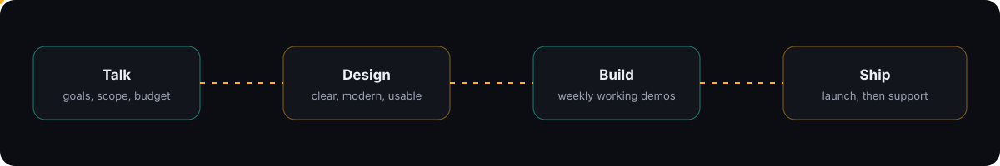

Vantyr is a small software company in Dhaka. We build websites, custom software, data dashboards and machine learning tools for startups and small businesses that want something that works and that they can keep maintaining.

<!--PINNED:START-->

Pinned projects will appear here.

<!--PINNED:END-->

---

Founded by <a href="https://github.com/souravsahapartho"><b>Sourav Saha</b></a> · Dhaka, Bangladesh · <a href="mailto:vantyr@sourav.com.bd">vantyr@sourav.com.bd</a>

